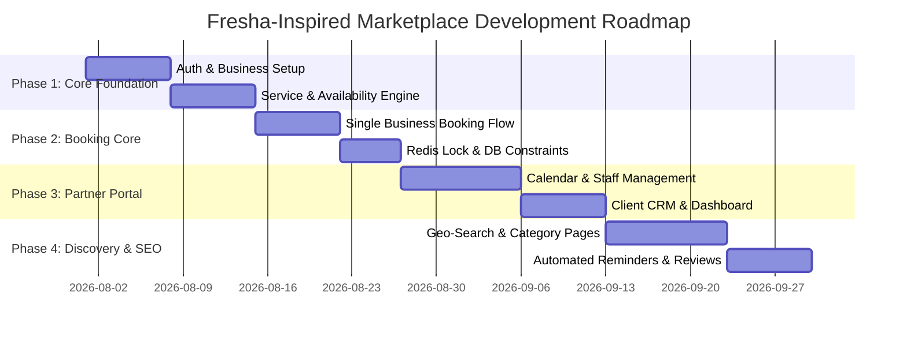

# Implementation Plan & Blueprint: Fresha-Inspired Appointment Booking Marketplace

A comprehensive research study, strategic product plan, and technical roadmap for building a high-growth, two-sided appointment booking marketplace inspired by **Fresha**.

---

## 1. Executive Summary & Fresha Business Model Research

### Why Fresha Succeeded
Fresha disruptively scaled to become the world's leading beauty and wellness marketplace by **flipping traditional B2B SaaS pricing**:
* **Freemium Business Software**: Salon, spa, and barber owners get enterprise-grade calendar, appointment scheduling, POS, staff management, and CRM without paying recurring monthly subscription fees.
* **Monetization via Monetized Transactions**:
  1. **New Client Acquisition Fee**: Fresha takes a percentage (~20%) only on the first booking when a new client discovers a business via the consumer marketplace. Repeat bookings from that client are 0% commission.
  2. **Payment Processing**: Revenue generated via integrated checkout, card-on-file deposits, and POS terminals.
* **The Marketplace Flywheel**:
  $$\text{Free B2B SaaS} \longrightarrow \text{Massive Supply Onboarding} \longrightarrow \text{Rich Marketplace Inventory} \longrightarrow \text{High Consumer Traffic} \longrightarrow \text{More Bookings}$$

---

## 2. Product Architecture & Scope

Based on the strategic blueprint in [booking-marketplace-architecture.pdf](file:///e:/ezment/booking-marketplace-architecture.pdf), the platform consists of three core applications sharing a unified backend engine:

```
                      ┌──────────────────────────────────────┐
                      │            CDN / Edge                │
                      │  (Static Assets, SEO SSR/SSG Pages)  │
                      └──────────────────┬───────────────────┘
                                         │
                      ┌──────────────────┴───────────────────┐
                      │          API Gateway / BFF           │
                      │   (Auth, Rate Limiting, Routing)     │
                      └──────────────────┬───────────────────┘
                                         │
        ┌────────────────────────────────┼────────────────────────────────┐
        ▼                                ▼                                ▼
┌──────────────┐                 ┌──────────────┐                 ┌──────────────┐
│  Search &    │                 │  Booking &   │                 │   Business   │
│  Discovery   │                 │ Scheduling   │                 │ Management   │
└───────┬──────┘                 └──────┬───────┘                 └──────┬───────┘
        │                               │                                │
        └────────────────────────────────┼────────────────────────────────┘
                                         │
               ┌─────────────────────────┴────────────────────────┐
               ▼                                                  ▼
    ┌────────────────────┐                             ┌────────────────────┐
    │  Notifications Svc │                             │ Reviews & Ratings  │
    └──────────┬─────────┘                             └──────────┬─────────┘
               │                                                  │
    ┌──────────┴──────────────────────────────────────────────────┴─────────┐
    │                         Shared Data Layer                             │
    │ PostgreSQL (Core DB) ── Redis (Cache/Locks) ── S3 Storage (Media)     │
    └────────────────────────────────────┬──────────────────────────────────┘
                                         │
                            ┌────────────┴───────────┐
                            │      Event Bus         │
                            │ (Async Reminders/Jobs) │
                            └────────────────────────┘
```

### Core User-Facing Subsystems
1. **Consumer Web App & PWA**:
   * Geo-location search (city/category/nearby).
   * Interactive service picker, staff selection, date/time slot builder.
   * Frictionless checkout (Pay at venue for v1 / Card-on-file later).
   * User appointment dashboard (upcoming/past bookings, cancellation, reviews).
2. **Business Partner Portal**:
   * Interactive drag-and-drop daily/weekly schedule calendar.
   * Service & pricing catalog configuration.
   * Staff profile, working hours, and time-off/vacation manager.
   * Client CRM (booking history, contact info, no-show flags).
   * Revenue and appointment analytics.
3. **Platform Admin Operations**:
   * Business listing approval & onboarding verification.
   * Global category & location management.
   * Review moderation and dispute handling.

---

## 3. Critical Technical Patterns & Constraints

### A. Preventing Double-Booking (Race Conditions)
To guarantee zero double-bookings under concurrent client bookings:
1. **Redis Slot Locking**: When a consumer selects a slot and enters checkout, a short-lived Redis lock (`staff_id:start_datetime`, ~30–60s TTL) is claimed.
2. **Database Exclusion Constraint**: PostgreSQL DB transaction uses an exclusion constraint to strictly reject overlapping ranges:
   ```sql
   ALTER TABLE bookings ADD CONSTRAINT no_overlapping_staff_appointments
   EXCLUDE USING gist (
     staff_id WITH =,
     tstzrange(start_datetime, end_datetime) WITH &&
   );
   ```

### B. Dynamic Availability Calculation
$$\text{Available Slots} = \text{Working Hours} \setminus (\text{TimeOff Exceptions} \cup \text{Existing Bookings})$$

### C. Timezone Handling
* All timestamp data is strictly persisted in **UTC**.
* Each business stores its local **IANA Timezone identifier** (e.g., `America/New_York`, `Europe/London`).
* Conversion to local time occurs purely at display layer.

### D. SEO & Geo-Search Engine
* Programmatic routes: `/[category]/in/[city]` (e.g., `/hair-salons/in/new-york`) using Next.js ISR.
* Spatial query execution using PostgreSQL PostGIS:
  ```sql
  SELECT * FROM locations 
  WHERE ST_DWithin(geom, ST_MakePoint(lng, lat)::geography, radius_meters);
  ```

---

## 4. User Review Required & Design Decisions

> [!IMPORTANT]
> **V1 Strategy Scope**: As specified in the architectural document, initial launch (v1) focuses on **in-person payments ("Pay at store")** to minimize regulatory overhead (PCI compliance, payment gateway payout splitting) and maximize seller onboarding speed.

> [!TIP]
> **No-Show Mitigation without Deposits**:
> 1. Mobile/SMS OTP verification prior to booking.
> 2. Automated SMS/Email reminders at 24-hour and 2-hour marks.
> 3. Consumer "3-Strikes" automated flag for non-attendance.

---

## 5. Recommended Tech Stack

| Domain | Technology | Justification |
| :--- | :--- | :--- |
| **Frontend Framework** | Next.js (React) + TypeScript | SSR/SSG for SEO, rapid dynamic client-side rendering for calendar & booking. |
| **Styling & Design** | Vanilla CSS / Tailored CSS Tokens | Sleek, modern aesthetic with glassmorphism, responsive micro-animations. |
| **Backend API** | Node.js (NestJS / Express) + TypeScript | Strongly typed domain modules matching business logic cleanly. |
| **Database** | PostgreSQL + PostGIS | Relational integrity, range exclusion constraints for non-overlapping slots. |
| **Caching & Locking** | Redis | Fast temporary slot reservation locks, session caching. |
| **Background Queue** | BullMQ (Redis-backed) | Scheduled reminders (24h/2h prior), transactional emails. |
| **Notifications** | Twilio (SMS) / SendGrid (Email) | High-deliverability transactional messaging. |

---

## 6. Phased Implementation Roadmap



### Phase 1: Data Model, Auth & Business Setup
* Setup workspace architecture, database schemas, and API scaffolding.
* Implement User, Business, Staff, Service, and Availability models.

### Phase 2: Booking Engine & Concurrency Locks
* Implement dynamic slot calculation API.
* Implement Redis lock + PostgreSQL exclusion constraint against double bookings.
* Build consumer single-business booking UI flow.

### Phase 3: Business Partner Management Portal
* Build interactive Calendar View (Day/Week per staff member).
* Build Service & Pricing management UI.
* Build Client list & booking history CRM.

### Phase 4: Search, Discovery & SEO Marketplace Engine
* Programmatic SSG/ISR category x city routes.
* PostGIS geo-radius search API.
* Automated SMS/Email notifications (BullMQ + Twilio/SendGrid).

---

## 7. Verification & Quality Assurance Plan

### Automated Verification
* Unit tests for availability calculation algorithm (`Availability` - `TimeOff` - `Bookings`).
* Integration tests verifying Redis locking & race condition handling under 50 simultaneous slot booking requests.

### Manual Verification
* End-to-end booking walkthrough as consumer.
* Schedule management verification as business owner.
* Geo-location search verification across multiple simulated cities.
